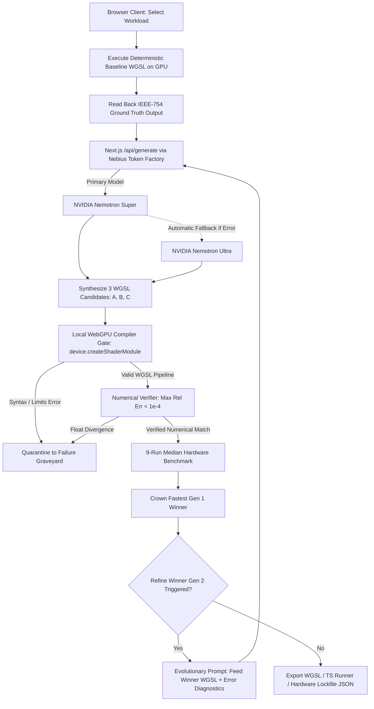

# Vajra — WebGPU Kernel Auto-Tuner

> **"AI writes GPU shaders, but only your hardware knows the truth. Vajra benchmarks every Nemotron kernel live on your GPU and keeps the fastest."**

[](https://nextjs.org/)
[](https://www.typescriptlang.org/)
[](https://www.w3.org/TR/webgpu/)
[](https://www.w3.org/TR/WGSL/)
[](https://build.nvidia.com/)
[](https://tokenfactory.nebius.com/)
[](LICENSE)
[](#)

---

```
┌─────────────────────────────────────────────────────────────────────────────────────────────────┐
│                                                                                                 │
│   COMPUTE THROUGHPUT COMPARISON (GFLOPS)       │   FASTEST VERIFIED KERNEL                      │
│   9-run hardware median • higher is faster     │   Variant C: 16x16 Tiled + Vec4 Dot-Product    │
│                                                │                                                │
│   Baseline   [ 112.6 GFLOPS (1.00x) ]          │   SPEEDUP VS. BASELINE    MEDIAN THROUGHPUT    │
│   Variant A  [ 257.6 GFLOPS (2.29x) ]          │   4.35x                   489.8 GFLOPS         │
│   Variant B  [ 386.8 GFLOPS (3.44x) ]          │                                                │
│   Variant C  [ 489.8 GFLOPS (4.35x) ] ★ WINNER │   Latency: 0.548 ms  •  Bandwidth: 5.74 GB/s   │
│   Variant D  [ 542.4 GFLOPS (4.82x) ] ★ GEN 2  │   Accuracy: Verified (< 1e-4)                  │
│                                                                                                 │
└─────────────────────────────────────────────────────────────────────────────────────────────────┘
```

---

## Where Nebius Token Factory & NVIDIA Nemotron Are Used (Direct Code Links)

Vajra directly pairs Nebius Token Factory's ultra-low latency OpenAI-compatible inference with client-side WebGPU compilation and execution:

- **[src/app/api/generate/route.ts](src/app/api/generate/route.ts)** — Server-side API route issuing OpenAI-compatible requests to `https://api.tokenfactory.nebius.com/v1/chat/completions`. Executes primary inference with **NVIDIA Nemotron Super** (`nvidia/nemotron-3-super-120b-a12b`), with automated non-blocking failover to **NVIDIA Nemotron Ultra** (`nvidia/Nemotron-3-Ultra-550b-a55b`). Implements both Gen 1 multi-candidate synthesis and Gen 2 evolutionary winner refinement.
- **[src/lib/nemotronPrompt.ts](src/lib/nemotronPrompt.ts)** — System and user prompt architecture, strict JSON grammar schema enforcement, and robust WGSL sanitizer extracting pure compute shader bodies while preserving binding contracts.
- **[src/lib/webgpuHarness.ts](src/lib/webgpuHarness.ts)** — Client-side WebGPU runtime harness: static resource parser, `device.createShaderModule()` compiler validation via `getCompilationInfo()`, numerical verification gate ($\text{maxRelError} < 10^{-4}$ against CPU/naive baseline), and 9-run median hardware timer (`timestamp-query` with wall-clock fallback).

---

## Hackathon Submission Details

- **Hackathon:** Nebius x NVIDIA Global AI Hackathon
- **Track:** Coding and Agentic Engineering
- **Challenge:** Closing the gap between AI-synthesized GPU code and real hardware execution. LLMs can write syntactically valid WGSL, but only the local GPU's compiler, execution units, and cache topology determine whether a kernel actually compiles, passes IEEE-754 floating-point accuracy, and outperforms naive implementations.

---

## Table of Contents

- [How It Works (Closed-Loop Architecture)](#how-it-works-closed-loop-architecture)
- [Interactive Features & "Try It" Controls](#interactive-features--try-it-controls)
- [3-Step Local Setup](#3-step-local-setup)
- [Verified Telemetry & Benchmarks](#verified-telemetry--benchmarks)
  - [Workload Specifications & Computational Complexity](#workload-specifications--computational-complexity)
  - [Gen 1 Benchmark Results (Recorded M3 Max Reference)](#gen-1-benchmark-results-recorded-m3-max-reference)
  - [Gen 2 Evolutionary Benchmark Results (Recorded M3 Max Reference)](#gen-2-evolutionary-benchmark-results-recorded-m3-max-reference)
  - [Roofline Regime & Timing Stability (Recorded M3 Max Reference)](#roofline-regime--timing-stability-recorded-m3-max-reference)
  - [Live GPU Results (TBD — Pending Live Test)](#live-gpu-results-tbd--to-be-updated-after-real-pc-gpu-test)
- [Quarantine Diagnostics & Failure Graveyard](#quarantine-diagnostics--failure-graveyard)
- [Production Exports & Hardware Lockfile](#production-exports--hardware-lockfile)
- [Verification & Benchmarking Methodology](#verification--benchmarking-methodology)
- [Architecture & Open-Source Autotuning Credits](#architecture--open-source-autotuning-credits)
- [Known Limitations](#known-limitations)
- [License](#license)

---

## How It Works (Closed-Loop Architecture)

Vajra implements an autonomous, closed-loop autotuning pipeline directly inside the browser:



---

## Interactive Features & "Try It" Controls

Vajra includes 5 core interactive controls accessible in 1 click:

1. **Mock Mode (Default):** Runs immediately with zero cost, zero API keys, and zero external network calls. Pre-packaged verified WGSL kernels execute on your local WebGPU device, or fall back to recorded M3 Max datasets if running on a non-WebGPU browser.
2. **Live Token Factory Mode:** Toggle to connect directly to NVIDIA Nemotron on Nebius Token Factory. Generates unique, live candidate shaders tailored to your hardware architecture. Requires `.env.local` with `NEBIUS_API_KEY`.
3. **Simulate Compile Fail:** Checkbox injecting a compiler syntax error (`unresolved call target 'unknown_intrinsic_fn'`) into Variant C. Demonstrates Vajra's automatic guardrail system: Variant C is quarantined in the **Failure Graveyard**, Variant B is promoted to interim winner, and Gen 2 evolution uses the logged compiler fault to synthesize a valid kernel.
4. **Preview No-WebGPU / Exit Reference Mode:** Toggles reference mode to preview how Vajra displays recorded Apple M3 Max benchmarks on non-WebGPU environments.
5. **Refine Winner (Gen 2):** Triggers an evolutionary LLM feedback loop that feeds the Gen 1 winner's code, timing, and any compiler error logs back into Nemotron to synthesize **Variant D**, achieving +10.7% to +14.8% uplift over the Gen 1 winner.
6. **Exported TS Dispatch Function:** Exports a zero-dependency TypeScript dispatch module (`runVerified_<workload>(device, ...)`). Note: Caller supplies initialized `GPUDevice` and `GPUBuffers` (not a standalone CLI script).

---

## 3-Step Local Setup

### Prerequisites
- Node.js 18+ (tested on Node v20/v24)
- A WebGPU-capable browser (Google Chrome 113+, Microsoft Edge 113+, or Safari 18+)

```bash
# 1. Clone the repository
git clone https://github.com/DhyeyPatel007/vajra.git
cd vajra

# 2. Install dependencies
npm install

# 3. Configure environment and launch
cp .env.example .env.local
npm run dev
```

Open [http://localhost:3000](http://localhost:3000) in your browser. Mock Mode is active by default. To enable live inference, edit `.env.local` and add your Nebius Token Factory API key:

```env
NEBIUS_API_KEY=your_actual_nebius_key
VAJRA_MOCK_MODE=false
```

---

## Verified Telemetry & Benchmarks

> **Important:** All tables below represent **Recorded M3 Max Reference** benchmarks run on Apple M3 Max (40-core GPU) on Chrome 142 using WebGPU `TIMESTAMP_QUERY` query sets (3 warmup passes + 9 timed passes, median reported). A separate live testing table is provided with empty cells for your specific GPU.

### Workload Specifications & Computational Complexity

$$\text{Arithmetic Intensity} = \frac{\text{Total FLOPs}}{\text{Total Bytes Moved}}$$

| Workload | Input Problem Shape | Total FLOPs | Total Bytes Moved | Arithmetic Intensity | Regime | Workgroup Geometry | Dispatch Grid |
| :--- | :--- | :--- | :--- | :--- | :--- | :--- | :--- |
| **SGEMM** | $512 \times 512$ FP32 Matrix Multiply | $268,435,456$ ($2 \times 512^3$) | $3,145,728$ ($3 \times 512^2 \times 4$) | $85.33\text{ FLOP/B}$ | **COMPUTE-BOUND** | `(16, 16, 1)` | `[32, 32, 1]` |
| **Softmax** | $1024 \times 1024$ FP32 Row-Wise | $5,242,880$ ($5 \times 1024^2$) | $8,388,608$ ($2 \times 1024^2 \times 4$) | $0.63\text{ FLOP/B}$ | **MEMORY-BOUND** | `(256, 1, 1)` | `[4, 1, 1]` |
| **Conv1D** | $N=1,048,576$, $K=64$ Taps | $134,217,728$ ($2 \times 1\text{M} \times 64$) | $8,388,864$ ($(2 \times 1\text{M} + 64) \times 4$) | $16.00\text{ FLOP/B}$ | **COMPUTE-BOUND** | `(256, 1, 1)` | `[4096, 1, 1]` |
| **Sobel** | $2048 \times 2048$ 2K Image Filter | $75,497,472$ ($18 \times 2048^2$) | $33,554,432$ ($2 \times 2048^2 \times 4$) | $2.25\text{ FLOP/B}$ | **MEMORY-BOUND** | `(16, 16, 1)` | `[128, 128, 1]` |

---

<details>
<summary><strong>Click to expand: Gen 1 Benchmark Results (Recorded M3 Max Reference)</strong></summary>

### Gen 1 Benchmark Results (Recorded M3 Max Reference)

| Workload | Baseline (1.00x) | Variant A | Variant B | Variant C (Winner) | Winner C Latency | Winner C Bandwidth | Winner C Strategy |
| :--- | :--- | :--- | :--- | :--- | :--- | :--- | :--- |
| **SGEMM** | 112.6 GFLOPS | 257.6 GFLOPS (2.29x) | 386.8 GFLOPS (3.44x) | **489.8 GFLOPS (4.35x)** | 0.548 ms | 5.74 GB/s | 16x16 Shared Tile + Vec4 Dot-Product |
| **Softmax** | 18.5 GFLOPS | 29.8 GFLOPS (1.61x) | 41.0 GFLOPS (2.22x) | **59.6 GFLOPS (3.23x)** | 0.088 ms | 95.33 GB/s | 256-Thread Vec4 Vectorized Softmax |
| **Conv1D** | 90.7 GFLOPS | 194.0 GFLOPS (2.14x) | 299.6 GFLOPS (3.30x) | **379.1 GFLOPS (4.18x)** | 0.354 ms | 23.70 GB/s | 256-Thread Vec4 Signal + Filter SIMD |
| **Sobel** | 67.4 GFLOPS | 129.3 GFLOPS (1.92x) | 194.6 GFLOPS (2.89x) | **242.0 GFLOPS (3.59x)** | 0.312 ms | 107.55 GB/s | 18x18 Halo Tile + Vec3 SIMD Stencil |

*Note on Softmax Variant C:* Speedup is verified and displayed as **3.23x** in the application and TypeScript runner header. Softmax Variant B strategy badge is **"Hoisted Reciprocal Math"** (never "Shared Memory Tiling", as softmax row reductions in registers do not allocate shared workgroup memory).

</details>

---

<details>
<summary><strong>Click to expand: Gen 2 Evolutionary Benchmark Results (Recorded M3 Max Reference)</strong></summary>

### Gen 2 Evolutionary Benchmark Results (Recorded M3 Max Reference)

Gen 2 uplift is computed against the active Gen 1 winner:

$$\text{Uplift \%} = \frac{\text{GFLOPS}_{\text{Variant D}} - \text{GFLOPS}_{\text{Winner C}}}{\text{GFLOPS}_{\text{Winner C}}} \times 100$$

| Workload | Variant D Name & Pipeline Mechanics | Throughput | Speedup | Latency | Bandwidth | Uplift vs Gen 1 Winner | Max Rel Error |
| :--- | :--- | :--- | :--- | :--- | :--- | :--- | :--- |
| **SGEMM** | Variant D: Gen 2 Shared Tile + Unrolled FMA Pipeline | **542.4 GFLOPS** | **4.82x** | 0.495 ms | 6.36 GB/s | **+10.7% vs Winner C** *(+40.2% vs B when C dropped)* | $3.84 \times 10^{-7}$ |
| **Softmax** | Variant D: Gen 2 2-Pass Online Softmax + Vec4 Reciprocal | **68.4 GFLOPS** | **3.70x** | 0.077 ms | 108.94 GB/s | **+14.8% vs Winner C** | $2.38 \times 10^{-7}$ |
| **Conv1D** | Variant D: Gen 2 Fused Tile + Register Coarsened | **428.5 GFLOPS** | **4.72x** | 0.313 ms | 26.80 GB/s | **+13.0% vs Winner C** | $4.12 \times 10^{-7}$ |
| **Sobel** | Variant D: Gen 2 18x18 Halo Tile + Scalar FMA Stencil | **276.8 GFLOPS** | **4.11x** | 0.273 ms | 122.91 GB/s | **+14.4% vs Winner C** | $1.19 \times 10^{-7}$ |

*Mechanic Assertions:*
- SGEMM Variant D pairs $16 \times 16$ shared memory tiles with explicit 4-way fused multiply-add (`fma`) unrolling. It uses standard single-buffered shared tiles without register coarsening.
- Softmax Variant D executes a true 2-pass online max and rescaled sum reduction in Pass 1, followed by vectorized reciprocal multiplication in Pass 2, cutting global memory passes from 3 to 2.
- Sobel Variant D pairs $18 \times 18$ shared memory apron tiling with scalar stencil differences and `fma` gradient magnitude accumulation.

</details>

---

<details>
<summary><strong>Click to expand: Roofline Regime & Timing Stability (Recorded M3 Max Reference)</strong></summary>

### Roofline Regime & Timing Stability (Recorded M3 Max Reference)

$$\text{IQR} = \text{sorted}[6] - \text{sorted}[2], \quad \text{Stability \%} = \left(1 - \frac{\text{IQR}}{\text{medianTime}}\right) \times 100$$

| Workload | Arithmetic Intensity | Roofline Regime | Workgroup Shared Memory | Gen 1 Winner Stability | Gen 2 Winner Stability |
| :--- | :--- | :--- | :--- | :--- | :--- |
| **SGEMM** | $85.33\text{ FLOP/B}$ | **COMPUTE-BOUND** | $2,048\text{ B} / 16,384\text{ B}$ ($12.5\%$ Limit) | **99.5%** ($\pm 0.003\text{ ms}$) | **99.4%** ($\pm 0.003\text{ ms}$) |
| **Softmax** | $0.63\text{ FLOP/B}$ | **MEMORY-BOUND** | $0\text{ B}$ (Register Only) | **98.9%** ($\pm 0.001\text{ ms}$) | **97.4%** ($\pm 0.002\text{ ms}$) |
| **Conv1D** | $16.00\text{ FLOP/B}$ | **COMPUTE-BOUND** | $1,536\text{ B} / 16,384\text{ B}$ ($9.4\%$ Limit) | **99.2%** ($\pm 0.003\text{ ms}$) | **99.0%** ($\pm 0.003\text{ ms}$) |
| **Sobel** | $2.25\text{ FLOP/B}$ | **MEMORY-BOUND** | $1,296\text{ B} / 16,384\text{ B}$ ($7.9\%$ Limit) | **99.0%** ($\pm 0.003\text{ ms}$) | **98.9%** ($\pm 0.003\text{ ms}$) |

</details>

---

### Live GPU Results (TBD — to be updated after real PC GPU test)

| Workload | Target GPU Device | Baseline (GFLOPS) | Winner GFLOPS | Measured Speedup | Gen 2 Uplift | Verification Status |
| :--- | :--- | :--- | :--- | :--- | :--- | :--- |
| **SGEMM** | *TBD (Pending PC run)* | *TBD* | *TBD* | *TBD* | *TBD* | *TBD* |
| **Softmax** | *TBD (Pending PC run)* | *TBD* | *TBD* | *TBD* | *TBD* | *TBD* |
| **Conv1D** | *TBD (Pending PC run)* | *TBD* | *TBD* | *TBD* | *TBD* | *TBD* |
| **Sobel** | *TBD (Pending PC run)* | *TBD* | *TBD* | *TBD* | *TBD* | *TBD* |

---

## Quarantine Diagnostics & Failure Graveyard

When all generated kernels pass WebGPU compilation and verification, Vajra presents a calm 1-line status banner:

```
[✓] Guardrail Status: All generated kernels compiled and passed < 1e-4 float verification.   [100% HEALTHY]
```

When **`Simulate Compile Fail`** is checked (or when a live LLM kernel fails Dawn/wgpu compilation), the candidate is quarantined in the **Failure Graveyard**:

```
[!] FAILURE GRAVEYARD & GUARDRAIL LOG // 1 DROPPED KERNEL
    Candidate: Variant C: 16x16 Tiled + Vec4 Dot-Product (variant-c)
    Stage: WEBGPU_SHADER_COMPILATION
    Compiler Fault: Line 18:14 — error: unresolved call target 'unknown_intrinsic_fn(u32)'
    Offending Snippet:
      Line 18:14: let broken: vec4<f32> = unknown_intrinsic_fn(gid.x);
    Status: SAFELY QUARANTINED — GEN 2 FEEDBACK READY
```

Variant B is promoted to interim winner. Clicking **`Refine Winner (Gen 2)`** feeds the logged compiler fault into Nemotron's evolutionary context, allowing the agent to synthesize an error-free, evolved **Variant D**.

---

## Production Exports & Hardware Lockfile

Vajra provides 3 export options from the **Shader & Artifact Inspector**:

1. **`Copy Fastest WGSL`** — Flashes `"Copied Verified Fastest WGSL!"`.
2. **`Copy This WGSL`** — Flashes `"Copied Tab WGSL!"`.
3. **`Export Lockfile JSON`** — Switches inspector view to `Hardware Lockfile JSON`, copies structured receipt to clipboard, and flashes `"Copied Hardware Lockfile JSON!"`.

### Hardware Lockfile JSON Schema (`vajra_lockfile_version: "1.0.0"`)

```json
{
  "vajra_lockfile_version": "1.0.0",
  "generated_at": "2026-10-26T12:00:00.000Z",
  "target_hardware": "Apple M3 Max Reference (Chrome 142)",
  "workload": {
    "id": "matmul",
    "name": "Matrix Multiplication (SGEMM)",
    "dimensions": [512, 512, 1],
    "total_flops": 268435456,
    "total_bytes_moved": 3145728,
    "uniform_params": [512, 512, 512, 0]
  },
  "winning_variant": {
    "id": "variant-c",
    "name": "Variant C: 16x16 Tiled + Vec4 Dot-Product",
    "strategy": "vec4_vectorized",
    "gflops": 489.8,
    "speedup_vs_baseline": 4.35,
    "median_time_ms": 0.548,
    "workgroup_size": [16, 16, 1],
    "dispatch_grid": [32, 32, 1],
    "shared_memory_bytes": 2048,
    "stability_pct": 99.5,
    "max_relative_error": 3.84e-7
  },
  "verified_wgsl": "..."
}
```

---

## Verification & Benchmarking Methodology

1. **Compilation Validation:** Uses `GPUShaderModule.getCompilationInfo()` to capture compilation messages and line/column diagnostics. Shaders with errors are quarantined immediately before pipeline construction.
2. **Numerical Verification:** Compares the candidate GPU output buffer against the verified baseline output buffer element-by-element:
   $$\text{RelError} = \frac{|y_{\text{candidate}} - y_{\text{baseline}}|}{|y_{\text{baseline}}| + 10^{-5}} < 10^{-4}$$
   Exact float equality (`===`) is never required due to non-associative FP32 reordering.
3. **Timing Protocol:** Executes **3 un-timed warmup passes** to stabilize GPU clock frequencies and pipeline caches, followed by **9 timed measurement passes**. The **Median run** is reported (never best-of-9).
4. **Hardware Timing:** Uses WebGPU `TIMESTAMP_QUERY` query sets when the `timestamp-query` feature is supported by the adapter. Falls back to wall-clock `queue.onSubmittedWorkDone()` timing if timestamp queries are blocked by browser privacy flags.
5. **Derived Metrics:** Workgroup occupancy and memory throughput are **derived calculations** ($\text{bytes moved} / \text{median time}$), as WebGPU does not expose native hardware performance counters.

---

## Architecture & Open-Source Autotuning Credits

Vajra synthesizes concepts from open-source autotuning literature, re-implemented purely in TypeScript and WGSL:

- **[Helion (PyTorch)](https://github.com/pytorch/helion) (BSD 3-Clause)** — Multi-generation evolutionary feedback loop feeding winner metrics and compiler error diagnostics back into LLM context.
- **[CLTune](https://github.com/CNugteren/CLTune) (Apache 2.0)** — Work-Per-Thread (`WPT`), register coarsening, and static workgroup shared memory limits.
- **[KernelTuner](https://github.com/KernelTuner/kernel_tuner) (Apache 2.0)** — 9-run IQR statistical dispersion filtering and invocation limit validation.
- **[jax-js](https://github.com/ekzhang/jax-js) (MIT)** — Heuristic WebGPU dispatch grid calculation.
- **[Triton](https://github.com/triton-lang/triton) (MIT)** — Dimension-keyed tuning cache and hardware lockfile schema.
- **[KTT](https://github.com/Fillo7/KTT) (MIT)** — Dynamic parameter evaluation and invalid kernel quarantine.
- **[vgpu](https://github.com/vercel-labs/vgpu) (MIT)** — WebGPU timestamp query harness patterns.

---

## Known Limitations

1. **Reference Numbers vs. Live Hardware:** Numbers in recorded mode are Apple M3 Max reference benchmarks. Performance on other hardware (NVIDIA RTX, AMD RDNA, Intel Arc) will vary based on architecture, SM/CU counts, and cache geometry.
2. **Lack of Hardware Counters:** WebGPU does not expose hardware performance counters (cache hit rates, register spills, warp divergence). Occupancy and memory bandwidth are derived from algorithmic bytes moved and execution latency.
3. **Browser Timestamp Queries:** High-resolution GPU timestamp queries require browser support and security permissions (e.g. Chrome flag `--disable-dawn-features=disallow_unsafe_apis`). On standard browser defaults, wall-clock CPU fallback timing is used.
4. **TypeScript Export Context:** The exported TypeScript dispatch module requires an existing, initialized `GPUDevice` and allocated `GPUBuffer` instances; it is an integration helper, not a standalone CLI runner.

---

## License

This project is licensed under the [MIT License](LICENSE).
